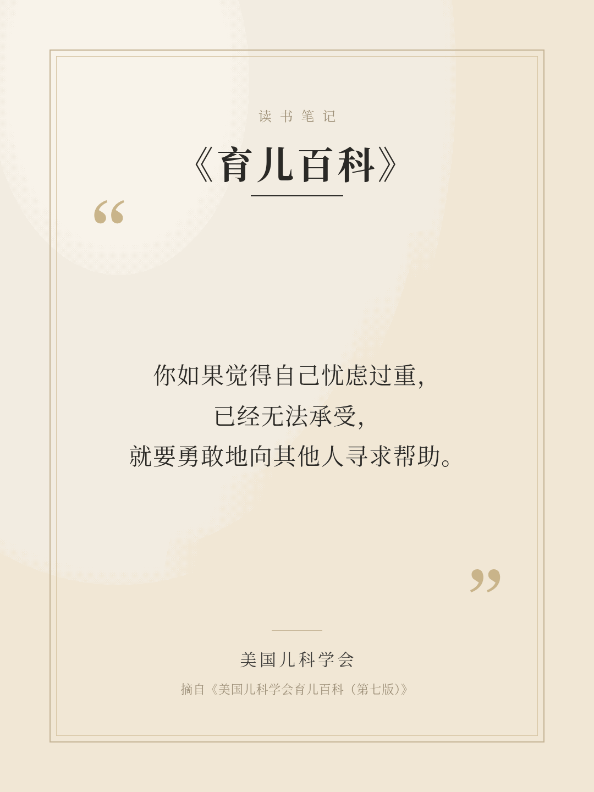
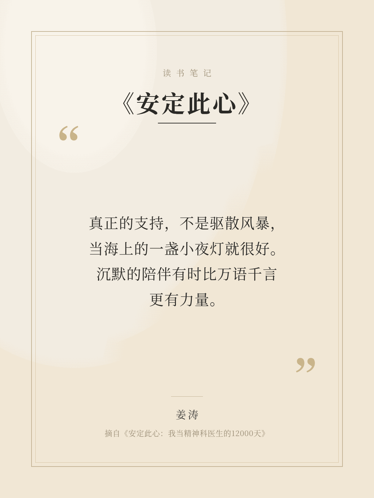
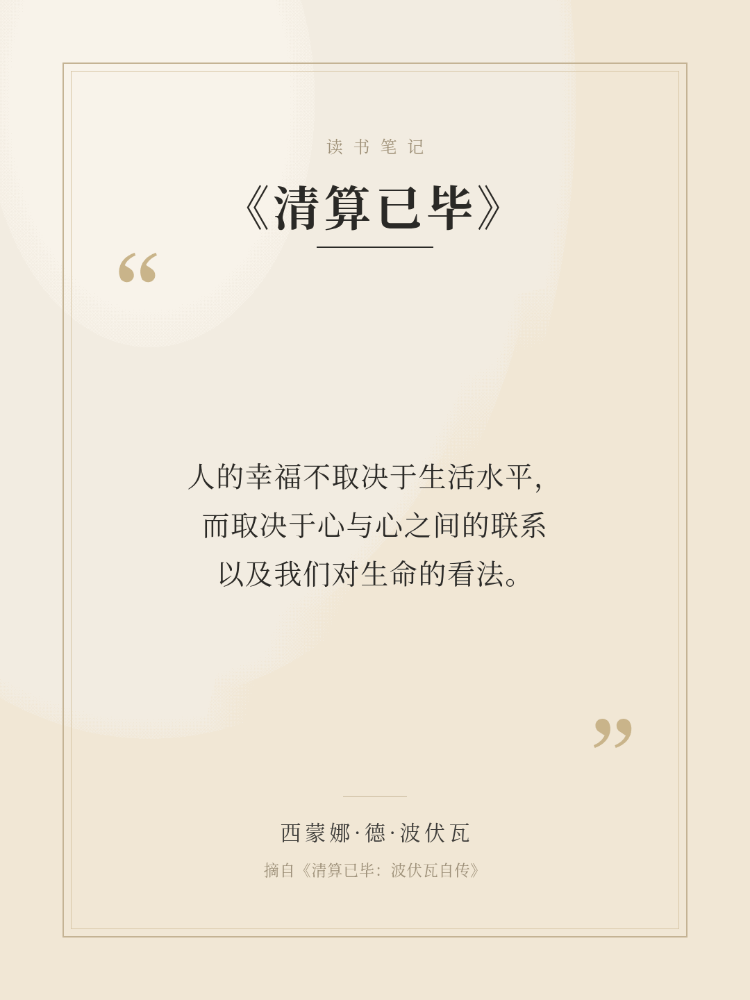
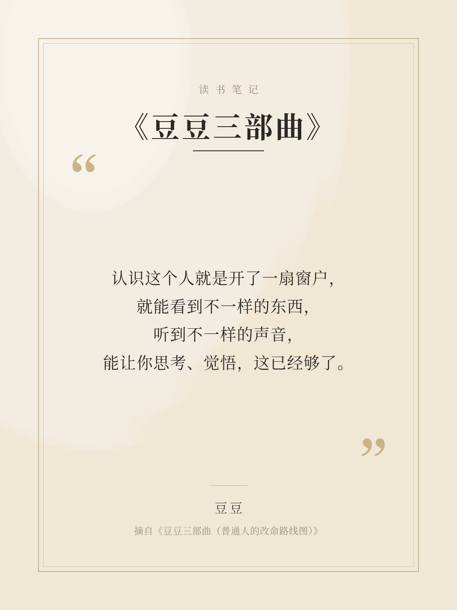

## Gitblog
My personal blog using issues and GitHub Actions
[RSS Feed](https://raw.githubusercontent.com/zfy68/gitblog/master/feed.xml)

## [友情链接](https://github.com/zfy68/gitblog/issues/24)
<table>
<thead>
<tr>
<th>Name</th>
<th>Link</th>
<th>Desc</th>
</tr>
</thead>
<tbody>
<tr>
<td>yihong0618</td>
<td>https://github.com/yihong0618</td>
<td>gitblog founder</td>
</tr>
</tbody>
</table>

## 最近更新
- [待读清单](https://github.com/zfy68/gitblog/issues/101)--2026-11-25
- [《美国儿科学会育儿百科（第七版）》](https://github.com/zfy68/gitblog/issues/100)--2026-11-24
- [《安定此心：我当精神科医生的12000天》✓](https://github.com/zfy68/gitblog/issues/99)--2026-11-24
- [《清算已毕：波伏瓦自传》✓](https://github.com/zfy68/gitblog/issues/98)--2026-11-24
- [《豆豆三部曲（普通人的改命路线图）》](https://github.com/zfy68/gitblog/issues/97)--2026-11-24
## 读书笔记

<table>
  <tr>
    <td align="center" width="25%" valign="top">
      <a href="https://github.com/zfy68/gitblog/issues/101">
         
        待读清单
      </a> 
      2026-11-25
    </td>
    <td align="center" width="25%" valign="top">
      <a href="https://github.com/zfy68/gitblog/issues/100">
         
        《美国儿科学会育儿百科（第七版）》
      </a> 
      2026-11-01 开始
 
      不要因为没有正确地给孩子换尿布或没能按时带孩子出门而自责。只要大家都平安健康，你就应该从容度过每一天并享受其中的每一分钟。
    </td>
    <td align="center" width="25%" valign="top">
      <a href="https://github.com/zfy68/gitblog/issues/99">
         
        《安定此心：我当精神科医生的12000天》✓
      </a> 
      2026-10-07 / 2026-11-22
 
      我们每天都在清扫看得见的垃圾，却对那些在心里腐烂的精神痛苦视而不见。
    </td>
    <td align="center" width="25%" valign="top">
      <a href="https://github.com/zfy68/gitblog/issues/98">
         
        《清算已毕：波伏瓦自传》✓
      </a> 
      2026-10-27 / 2026-11-14
 
      能确定的是，我对自己的命运非常满意，从不希望它是任何其他样子。推动我完成命运的因素，在我看来皆是幸运。
    </td>
  </tr>
  <tr>
    <td align="center" width="25%" valign="top">
      <a href="https://github.com/zfy68/gitblog/issues/97">
         
        《豆豆三部曲（普通人的改命路线图）》
      </a> 
      2026-09-24 开始
 
      中国为什么穷？穷就穷在幼稚的思维，穷在期望救主、期望救恩的文化上，这是一个渗透到民族骨子里的价值判断体系，太可怕了。”
    </td>
    <td align="center" width="25%" valign="top">
      <a href="https://github.com/zfy68/gitblog/issues/96">
         
        《第一性原理：普通人的人生高效手册》✓
      </a> 
      2026-09-19 / 2026-09-22
 
      不接受任何预先设定好的结论，回到最基础的事实后再做推理。
    </td>
    <td align="center" width="25%" valign="top">
      <a href="https://github.com/zfy68/gitblog/issues/95">
         
        《结构性改革》✓
      </a> 
      2026-10-14 / 2026-10-31
 
      总之，在面对复杂问题的时候，掌握马克思主义辩证法的基本规律，遵循“问题—结构—对策”的逻辑分析范式，问题基本上能迎刃而解。
    </td>
    <td align="center" width="25%" valign="top">
      <a href="https://github.com/zfy68/gitblog/issues/94">
         
        《左耳听风》传奇程序员练级攻略
      </a> 
      2024-06-18
    </td>
  </tr>
</table>

## 语录卡片

<table>
  <tr>
    <td align="center" width="25%" valign="top">
      
    </td>
    <td align="center" width="25%" valign="top">
      
    </td>
    <td align="center" width="25%" valign="top">
      
    </td>
    <td align="center" width="25%" valign="top">
      
    </td>
  </tr>
</table>

## 2015

<table>
  <tr>
    <td width="96" valign="top">
      
    </td>
    <td valign="top">
      <a href="https://github.com/zfy68/gitblog/issues/54"><strong>愿你以梦为马，随处可栖</strong></a> 
      2022-10-29
    </td>
  </tr>
</table>

## 2016

<table>
  <tr>
    <td width="96" valign="top">
      
    </td>
    <td valign="top">
      <a href="https://github.com/zfy68/gitblog/issues/53"><strong>依旧阳光</strong></a> 
      2022-10-29
    </td>
  </tr>
</table>

## 2017

<table>
  <tr>
    <td width="96" valign="top">
      
    </td>
    <td valign="top">
      <a href="https://github.com/zfy68/gitblog/issues/55"><strong>只有天空在上</strong></a> 
      2022-10-29
    </td>
  </tr>
</table>

## 2018

<table>
  <tr>
    <td width="96" valign="top">
      
    </td>
    <td valign="top">
      <a href="https://github.com/zfy68/gitblog/issues/4"><strong>等待已久</strong></a> 
      2021-12-03 
      晚夜袭风几处真？星月不曾与天分。 曾于秋霜相交默，未必相知心上人。 作者：子非鱼 微爱 ---- 邂逅一个人，我等了上千年。 偶遇一个人，我等了若百年。 和她在一起的日子,有无尽的欢乐.她的性格、脾气不怎么好，可我却是百般喜欢。有了她，自然是世界上最幸福的人,这是在秀恩爱吗?我想…
    </td>
  </tr>
</table>

## 2019

<a href="https://github.com/zfy68/gitblog/issues/5"><strong>步入社会的我</strong></a> 
2021-12-03

诗人只为了一种模糊的感受、一种调调儿、一种情绪去写。 在靠近海岸是穿上救生衣，但在海中央时把救生衣抛掉吧

## 2020

<a href="https://github.com/zfy68/gitblog/issues/6"><strong>迷茫的我</strong></a> 
2021-12-03

像是无边的黑暗穿进我心里，再也逃不出去，与世界分离 徐徐的晚风，春夏又秋冬

## 2021
- [初来乍到](https://github.com/zfy68/gitblog/issues/2)--2021-12-03
- [死亡不是终点，遗忘才是！](https://github.com/zfy68/gitblog/issues/3)--2021-12-03
- [痛苦的时候，就是成长的时候](https://github.com/zfy68/gitblog/issues/7)--2021-12-04
- [Log4j RCE 凑个热闹](https://github.com/zfy68/gitblog/issues/11)--2021-12-10
- [2021年述职汇报](https://github.com/zfy68/gitblog/issues/20)--2022-01-10
## 2022
- [新年第一天-徒步爬山13公里](https://github.com/zfy68/gitblog/issues/18)--2022-01-01
- [ToB 和ToC 产品](https://github.com/zfy68/gitblog/issues/19)--2022-01-10
- [科技创新让生活更美好？](https://github.com/zfy68/gitblog/issues/21)--2022-01-10
- [为什么不用Docker？](https://github.com/zfy68/gitblog/issues/22)--2022-01-14
- [RabbitMQ Consumer source code ](https://github.com/zfy68/gitblog/issues/23)--2022-01-17

显示更多

- [心中有了答案，却还要选择](https://github.com/zfy68/gitblog/issues/25)--2022-01-22
- [home，下雪啦](https://github.com/zfy68/gitblog/issues/26)--2022-01-27
- [路上皆是风景，家是终点](https://github.com/zfy68/gitblog/issues/27)--2022-01-28
- [踩雪](https://github.com/zfy68/gitblog/issues/28)--2022-02-02
- [荡秋千，喝酒不足以味人生](https://github.com/zfy68/gitblog/issues/29)--2022-02-03
- [归来还是少年](https://github.com/zfy68/gitblog/issues/30)--2022-02-05
- [假期结束，2022启航！](https://github.com/zfy68/gitblog/issues/31)--2022-02-08
- [我焦虑了](https://github.com/zfy68/gitblog/issues/33)--2022-03-12
- [Tie is important for men](https://github.com/zfy68/gitblog/issues/34)--2022-04-10
- [
非常时期囤货手册](https://github.com/zfy68/gitblog/issues/35)--2022-04-10
- [war is over](https://github.com/zfy68/gitblog/issues/39)--2022-04-18
- [去国怀乡，忧谗畏讥](https://github.com/zfy68/gitblog/issues/49)--2022-09-01
- [分享问题等于解决问题的一半。](https://github.com/zfy68/gitblog/issues/51)--2022-10-14

## 2023
- [去大理](https://github.com/zfy68/gitblog/issues/56)--2022-12-31
- [23年微观改变](https://github.com/zfy68/gitblog/issues/57)--2023-01-20
- [问道青城山](https://github.com/zfy68/gitblog/issues/62)--2023-03-05
- [一点想法（经济和教育）](https://github.com/zfy68/gitblog/issues/64)--2023-03-11
- [What is a Vector Database?](https://github.com/zfy68/gitblog/issues/65)--2023-03-11

显示更多

- [TCP粘包](https://github.com/zfy68/gitblog/issues/66)--2023-03-13
- [Connected Papers](https://github.com/zfy68/gitblog/issues/70)--2023-03-19
- [Salman Amin Khan](https://github.com/zfy68/gitblog/issues/71)--2023-03-19
- [Steamship( Ship AI Faster)](https://github.com/zfy68/gitblog/issues/72)--2023-03-19
- [梦里梦外](https://github.com/zfy68/gitblog/issues/78)--2023-06-28
- [2023.7.2 我在南门](https://github.com/zfy68/gitblog/issues/79)--2023-07-03
- [摘录自【白板报】](https://github.com/zfy68/gitblog/issues/80)--2023-07-09
- [这夏天热的烦躁，躺着都累，最近在持续游泳](https://github.com/zfy68/gitblog/issues/81)--2023-07-09
- [生命很短，路很长](https://github.com/zfy68/gitblog/issues/82)--2023-07-21
- [黑暗和光](https://github.com/zfy68/gitblog/issues/83)--2023-07-26
- [散步疗养](https://github.com/zfy68/gitblog/issues/84)--2023-08-03
- [肩颈的救赎](https://github.com/zfy68/gitblog/issues/85)--2023-08-09
- [是世道变了还是你没觉醒](https://github.com/zfy68/gitblog/issues/86)--2023-08-15
- [海边踩单车](https://github.com/zfy68/gitblog/issues/87)--2023-09-21
- [Hong Kong](https://github.com/zfy68/gitblog/issues/88)--2023-09-24
- [服务器混战三十年，从外资三巨头到国产F4](https://github.com/zfy68/gitblog/issues/89)--2023-10-13

## help wanted
- [Eslint,spotless,git commit template使用](https://github.com/zfy68/gitblog/issues/59)--2023-02-16
## bug
- [崩了](https://github.com/zfy68/gitblog/issues/37)--2022-04-14
## TEDTalk
- [What Happens to Gas Stations When the World Goes Electric? | Emily Grubert | TED](https://github.com/zfy68/gitblog/issues/74)--2023-03-25
## tool
- [YouTube Download Video/Subtitles](https://github.com/zfy68/gitblog/issues/75)--2023-03-25
- [cloudflare代理](https://github.com/zfy68/gitblog/issues/63)--2023-03-06
- [clash注册](https://github.com/zfy68/gitblog/issues/9)--2021-12-06
- [KMS激活工具](https://github.com/zfy68/gitblog/issues/8)--2021-12-06
## 读书笔记
- [待读清单](https://github.com/zfy68/gitblog/issues/101)--2026-11-25
- [《美国儿科学会育儿百科（第七版）》](https://github.com/zfy68/gitblog/issues/100)--2026-11-24
- [《安定此心：我当精神科医生的12000天》✓](https://github.com/zfy68/gitblog/issues/99)--2026-11-24
- [《清算已毕：波伏瓦自传》✓](https://github.com/zfy68/gitblog/issues/98)--2026-11-24
- [《豆豆三部曲（普通人的改命路线图）》](https://github.com/zfy68/gitblog/issues/97)--2026-11-24

显示更多

- [《第一性原理：普通人的人生高效手册》✓](https://github.com/zfy68/gitblog/issues/96)--2026-11-24
- [《结构性改革》✓](https://github.com/zfy68/gitblog/issues/95)--2026-11-24
- [《左耳听风》传奇程序员练级攻略](https://github.com/zfy68/gitblog/issues/94)--2024-06-18
- [《非暴力沟通》](https://github.com/zfy68/gitblog/issues/93)--2024-05-21
- [《白银时代》✓](https://github.com/zfy68/gitblog/issues/92)--2024-03-05
- [《黄金时代》✓](https://github.com/zfy68/gitblog/issues/91)--2024-01-06
- [《遥远的救世主》✓](https://github.com/zfy68/gitblog/issues/90)--2023-12-23
- [《The Old Man and the Sea》✔](https://github.com/zfy68/gitblog/issues/77)--2023-05-24
- [《ELON MUSK》](https://github.com/zfy68/gitblog/issues/76)--2023-04-03
- [《ArcGIS From Basics To Practice》](https://github.com/zfy68/gitblog/issues/73)--2023-03-23
- [《Silent Majority》Li Yinhe](https://github.com/zfy68/gitblog/issues/69)--2023-03-19
- [《Silent Majority》✔](https://github.com/zfy68/gitblog/issues/68)--2023-03-19
- [《Agile Software Development Principles, Patterns, and Practices》](https://github.com/zfy68/gitblog/issues/61)--2023-02-26
- [《THE McKINSEY WAY》original ✔](https://github.com/zfy68/gitblog/issues/60)--2023-02-25
- [《Karl Marx》✔](https://github.com/zfy68/gitblog/issues/58)--2023-02-15
- [《INVESTING The Last Liberal Art, Second Edition》✔](https://github.com/zfy68/gitblog/issues/52)--2022-10-25
- [《PMP》](https://github.com/zfy68/gitblog/issues/50)--2022-09-06
- [《Designing Data-Intensive Application》](https://github.com/zfy68/gitblog/issues/48)--2022-08-07
- [《Guns , Germs , and Steel》](https://github.com/zfy68/gitblog/issues/47)--2022-08-04
- [《THE McKINSEY WAY》✔](https://github.com/zfy68/gitblog/issues/46)--2022-08-01
- [《Never Give Up》 ✔](https://github.com/zfy68/gitblog/issues/45)--2022-07-24
- [《The Wealth of Nations (II) 》](https://github.com/zfy68/gitblog/issues/44)--2022-07-19
- [《West with the Night》✔](https://github.com/zfy68/gitblog/issues/42)--2022-07-10
- [《Secrets of the Temple》](https://github.com/zfy68/gitblog/issues/41)--2022-05-15
- [《Thinking fast and slow》✔](https://github.com/zfy68/gitblog/issues/40)--2022-04-25
- [《私はそうは思わない》✔](https://github.com/zfy68/gitblog/issues/32)--2022-02-08
- [《The Wealth of Nations (I) 》 ✔](https://github.com/zfy68/gitblog/issues/12)--2021-12-15

